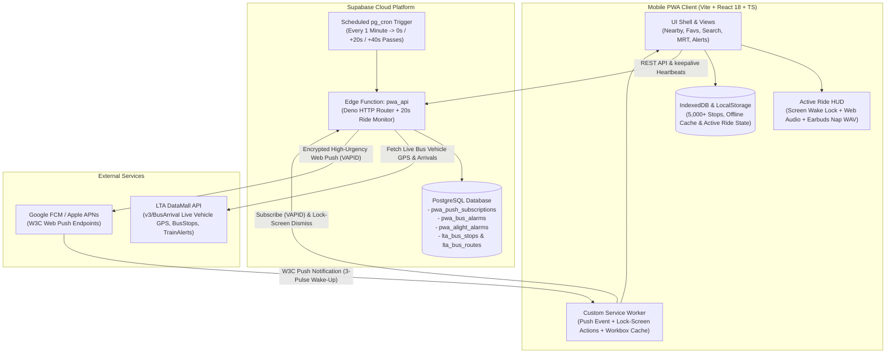
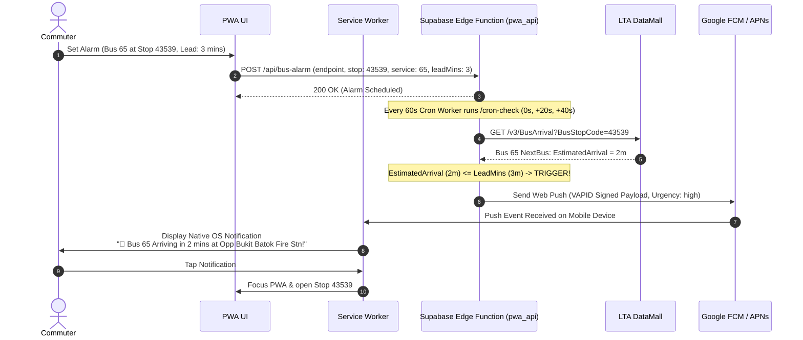
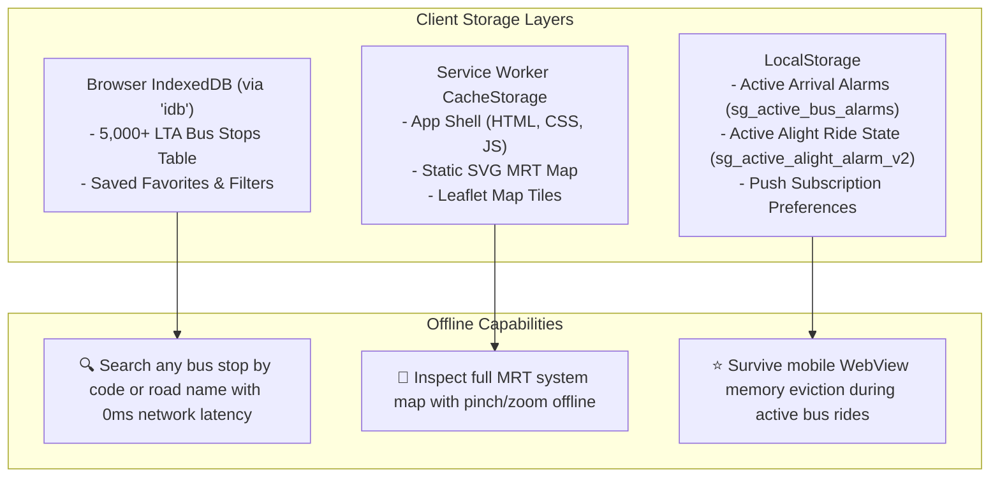

# 🏛️ System Architecture - SG Bus Kaki PWA

This document outlines the end-to-end technical architecture for the **SG Bus Kaki Progressive Web App (PWA)**, detailing the frontend client, service worker lifecycle, Web Push notification infrastructure, and Supabase Edge Function backend.

---

## 1. High-Level Architecture



---

## 2. Web Push Notification Architecture

Web Push allows the PWA to alert commuters on Android and iOS (installed Home Screen PWA) even when the user switches apps, closes the browser tab, or locks the phone screen.

### 2.1 VAPID Authentication Lifecycle

1. **VAPID Key Generation**:
   - The backend holds a cryptographic VAPID keypair (`VAPID_PUBLIC_KEY`, `VAPID_PRIVATE_KEY`).
2. **Client Subscription**:
   - When the commuter enables notifications in the Alerts Hub (or arms an Arrival / Alight alarm):
   ```typescript
   // 1. Fetch public key from Edge Function
   const { publicKey } = await fetch('/api/vapid-public-key').then(r => r.json());
   
   // 2. Subscribe via PushManager
   const registration = await navigator.serviceWorker.ready;
   const subscription = await registration.pushManager.subscribe({
     userVisibleOnly: true,
     applicationServerKey: urlBase64ToUint8Array(publicKey)
   });
   
   // 3. Save subscription payload to Supabase
   await fetch('/api/subscribe', {
     method: 'POST',
     headers: { 'Content-Type': 'application/json' },
     body: JSON.stringify({
       endpoint: subscription.endpoint,
       keys: {
         p256dh: btoa(String.fromCharCode(...new Uint8Array(subscription.getKey('p256dh')))),
         auth: btoa(String.fromCharCode(...new Uint8Array(subscription.getKey('auth'))))
       },
       mrt_lines: ['EWL', 'NSL'],
       alert_filter: 'major'
     })
   });
   ```

### 2.2 Dynamic Bus Arrival Countdown Push Flow



---

## 3. Alighting Wake-Up Alarm Architecture (Foreground + Background Cloud Hybrid)

Mobile browser engines (Chromium on Android and WebKit on iOS) strictly suspend `navigator.geolocation` whenever a PWA moves to the background (`document.visibilityState === 'hidden'`) or when the phone screen is turned off, and do not expose `navigator.geolocation` inside Service Workers.

To guarantee reliable alighting wake-up alerts whether the PWA is open, minimized behind another app, or running with the screen locked, SG Bus Kaki uses a **Dual-Layer Foreground + Server-Side Cloud Ride Engine**.

### 3.1 Background Cloud Tracking (Screen Off / App Switched)

1. **Atomic Cloud Registration & Last-Known Fix Handoff**:
   - Arming an Alight Alert saves state locally (`sg_active_alight_alarm_v2` in `localStorage`) and calls `POST /api/alight-alarm`, atomically upserting the VAPID subscription and registering the destination stop, threshold (`300m` / `400m` / `500m` / `800m`), and current user GPS/speed.
   - Whenever the user switches apps or locks the screen (`visibilitychange === 'hidden'` or `pagehide`), the client flushes a `{ keepalive: true }` `POST /api/alight-alarm/heartbeat` with the freshest GPS coordinates and approach velocity.
2. **Tier 1 — Server-Side Progressive Route-Checkpoint Relay (LTA Live Bus Vehicle GPS)**:
   - Using `lta_bus_routes` (26,800+ sequential route stops) and `lta_bus_stops` (5,200+ stops), `pwa_api` automatically discovers candidate connecting bus services from the commuter's boarding corridor to the destination stop (or locks immediately onto a user-selected bus service).
   - Every **20 seconds** (`pg_cron` 1-minute trigger + `EdgeRuntime.waitUntil` sub-passes at `0s`, `+20s`, and `+40s`), `pwa_api` queries LTA DataMall `v3/BusArrival` at a dynamic downstream checkpoint (`tracked_stop_seq + 2`), extracting the **physical bus vehicle's live `Latitude`, `Longitude`, and `EstimatedArrival`**—tracking the ride completely independent of the phone's suspended GPS!
   - Triggers a gentle heads-up pre-alert (`ALIGHT_PRE_ALERT`) at **2 stops away** and the urgent wake-up alarm (`ALIGHT_ALARM`) when `bus_distance_to_target <= alert_distance_meters`, `stops_remaining <= 1` (`<= 550m` or `ETA <= 75s`), or `ETA_to_target <= 50s`.
3. **Tier 2 — Kinematic Trajectory Velocity Fallback (MRT / Car / Unmatched Rides)**:
   - For non-bus rides (`velocity_fallback` mode) or when LTA bus GPS coordinates return `0.0`, `pwa_api` projects remaining distance from the last smoothed approach speed (`EMA` bounded to `3.5–18.0 m/s` transit corridor speeds) so background alerts still fire on schedule.
4. **3-Pulse High-Urgency VAPID Wake-Up Burst & Lock-Screen Dismissal**:
   - On trigger, `pwa_api` dispatches up to **3 distinct High-Urgency (`Urgency: high`, `TTL: 120`) Web Push pulses** at **`0s`**, **`+4s`**, and **`+10s`** (with unique notification tags so OS notification sound + urgent vibration re-fire).
   - Tapping **`"✅ I Have Alighted"`** directly on the lock-screen notification invokes `POST /api/alight-alarm/cancel` from `src/sw.ts`, aborting remaining reinforcement pulses and clearing all `alight-*` notifications without needing to unlock and open the app.

### 3.2 Foreground Active Ride HUD & Earbuds Nap Mode

1. **W3C Screen Wake Lock API & OLED Battery-Saver UI (`ActiveRideHUD`)**:
   - Acquires `navigator.wakeLock.request('screen')` while visible, paired with a pure-black (`#000000`) AMOLED HUD featuring 1-tap Ride Mode / Bus Service override pills (`[Auto]`, `[Bus X]`, `[MRT / Car]`).
2. **Web Audio API Multi-Tone Synthesizer + Tactile Haptics**:
   - Synthesizes an oscillating square-wave chime (`880 Hz -> 1760 Hz`) via `AudioContext` alongside `navigator.vibrate([800, 300, 800, 300, 1200])` when visible.
3. **Optional `"🎧 Earbuds Nap Mode"` (HTML5 `<audio>` Media Session Stream)**:
   - Generates an offline in-memory 16-bit PCM WAV chime blob URL (`getChimeWavBlobUrl`) and maintains an ultra-quiet background HTML5 `<audio>` media stream when toggled ON—allowing instant full-volume synthesized WAV chime playback directly into Bluetooth earbuds even while the screen is off.

---

## 4. Offline Storage & Caching Architecture

Commuters frequently experience network loss in subterranean MRT stations, tunnels, and underground bus interchanges.



---

## 5. Database Schema Specification (Supabase PostgreSQL)

```sql
-- 1. Web Push Subscriptions Table
CREATE TABLE IF NOT EXISTS pwa_push_subscriptions (
    id BIGSERIAL PRIMARY KEY,
    endpoint TEXT NOT NULL UNIQUE,
    p256dh TEXT NOT NULL,
    auth TEXT NOT NULL,
    mrt_lines TEXT[] DEFAULT ARRAY[]::TEXT[],
    alert_filter TEXT DEFAULT 'major', -- 'major' or 'all'
    user_agent TEXT,
    created_at TIMESTAMPTZ DEFAULT NOW(),
    updated_at TIMESTAMPTZ DEFAULT NOW()
);

CREATE INDEX IF NOT EXISTS idx_pwa_push_endpoint ON pwa_push_subscriptions(endpoint);

-- 2. Bus Arrival Countdown Alarms Table
CREATE TABLE IF NOT EXISTS pwa_bus_alarms (
    id BIGSERIAL PRIMARY KEY,
    endpoint TEXT NOT NULL REFERENCES pwa_push_subscriptions(endpoint) ON DELETE CASCADE,
    bus_stop_code VARCHAR(10) NOT NULL,
    bus_stop_name VARCHAR(120),
    service_no VARCHAR(10) NOT NULL,
    lead_mins INT NOT NULL DEFAULT 3,
    fired BOOLEAN NOT NULL DEFAULT FALSE,
    created_at TIMESTAMPTZ DEFAULT NOW(),
    expires_at TIMESTAMPTZ DEFAULT (NOW() + INTERVAL '45 minutes')
);

CREATE INDEX IF NOT EXISTS idx_pwa_alarms_active ON pwa_bus_alarms(fired, expires_at);

-- 3. Background Alighting Wake-Up Alarms Table
CREATE TABLE IF NOT EXISTS pwa_alight_alarms (
    id BIGSERIAL PRIMARY KEY,
    endpoint TEXT NOT NULL REFERENCES pwa_push_subscriptions(endpoint) ON DELETE CASCADE,
    target_stop_code VARCHAR(10) NOT NULL,
    target_stop_name VARCHAR(120),
    road_name VARCHAR(120),
    target_lat DOUBLE PRECISION NOT NULL,
    target_lon DOUBLE PRECISION NOT NULL,
    threshold_meters INT NOT NULL DEFAULT 500,
    tracking_mode VARCHAR(24) NOT NULL DEFAULT 'auto_detect', -- 'bus_locked' | 'auto_detect' | 'mrt' | 'trajectory_eta'
    service_no VARCHAR(12),
    direction INT,
    boarding_stop_seq INT,
    tracked_stop_seq INT,
    target_stop_seq INT,
    stops_remaining INT,
    last_user_lat DOUBLE PRECISION,
    last_user_lon DOUBLE PRECISION,
    last_user_speed_mps DOUBLE PRECISION,
    last_user_sync_at TIMESTAMPTZ,
    estimated_distance_meters INT,
    candidate_services TEXT[] DEFAULT ARRAY[]::TEXT[],
    metadata JSONB DEFAULT '{}'::JSONB,
    pre_alert_fired BOOLEAN NOT NULL DEFAULT FALSE,
    fired BOOLEAN NOT NULL DEFAULT FALSE,
    created_at TIMESTAMPTZ DEFAULT NOW(),
    updated_at TIMESTAMPTZ DEFAULT NOW(),
    expires_at TIMESTAMPTZ DEFAULT (NOW() + INTERVAL '2 hours 30 minutes')
);

CREATE INDEX IF NOT EXISTS idx_pwa_alight_active ON pwa_alight_alarms(fired, expires_at);
CREATE INDEX IF NOT EXISTS idx_pwa_alight_endpoint ON pwa_alight_alarms(endpoint);

-- 4. MRT Alert State Tracking Table (Shared with LTA Monitor)
CREATE TABLE IF NOT EXISTS pwa_mrt_alert_state (
    id INT PRIMARY KEY DEFAULT 1,
    last_status INT DEFAULT 1,
    last_affected JSONB DEFAULT '[]'::JSONB,
    last_message TEXT,
    updated_at TIMESTAMPTZ DEFAULT NOW()
);
```

---

## 6. Backend API Specification (`pwa_api`)

Base URL: `https://<supabase-project-ref>.supabase.co/functions/v1/pwa_api`

| Endpoint | Method | Payload | Response | Description |
| :--- | :--- | :--- | :--- | :--- |
| `/api/vapid-public-key` | `GET` | None | `{ publicKey: string }` | Returns public VAPID key for PushManager |
| `/api/subscribe` | `POST` | `{ endpoint, keys, mrt_lines, alert_filter }` | `{ ok: true }` | Registers or updates Web Push subscription |
| `/api/bus-alarm` | `POST` | `{ endpoint, stopCode, stopName, serviceNo, leadMins }` | `{ ok: true, alarmId }` | Arms dynamic arrival countdown alarm |
| `/api/bus-alarm/:id` | `DELETE` | None | `{ ok: true }` | Cancels active arrival alarm |
| `/api/alight-alarm` | `POST` | `{ endpoint, keys?, targetStopCode, targetLat, targetLon, thresholdMeters, serviceNo?, userLat?, userLon? }` | `{ ok: true, alarm }` | Arms background cloud alighting alarm & resolves connecting bus routes |
| `/api/alight-alarm/heartbeat` | `POST` | `{ endpoint, alarmId?, userLat?, userLon?, userSpeedMps?, thresholdMeters?, overrideMode?, overrideServiceNo? }` | `{ ok: true, alarm }` | Syncs foreground/keepalive GPS fix, speed, or 1-tap ride mode override |
| `/api/alight-alarm/status` | `GET` | Query: `?endpoint=...&id=...` | `{ ok: true, alarm }` | Reconciles live server-tracked stops remaining & distance on app resume |
| `/api/alight-alarm/:id` | `DELETE` | Query: `?endpoint=...` | `{ ok: true }` | Cancels active alighting alarm |
| `/api/alight-alarm/cancel` | `POST` | `{ endpoint?, alarmId? }` | `{ ok: true, cancelled }` | Lock-screen Service Worker dismissal & reinforcement pulse abort |
| `/api/bus-nearby` | `GET` | Query: `?lat=1.35&lon=103.82&limit=15` | `{ ok: true, stops: [...] }` | Returns nearby bus stops sorted by distance |
| `/api/bus-arrivals` | `GET` | Query: `?stop=43539` | `{ ok: true, stopCode, services: [...] }` | Returns live arrivals, loads, and fleet types |
| `/api/bus-search` | `GET` | Query: `?q=Orchard` | `{ ok: true, stops: [...], services: [...] }` | Search stops and service routes |
| `/api/bus-route` | `GET` | Query: `?service=65&direction=1` | `{ ok: true, stops: [...] }` | Returns sequential stops for bus route |
| `/cron-check` | `POST` | Authorization header | `{ processedAlarms, alightPass1, alightPass2, alightPass3, mrtAlertsSent }` | 1-minute cron executing 20s sub-passes for arrival alarms, alight tracking & MRT health |
